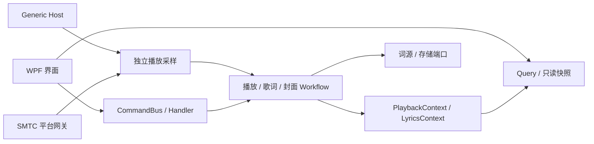

# Stanza

Windows 11 任务栏上的轻量歌词小组件。通过系统媒体会话（SMTC）获取当前播放，显示同步歌词、逐字卡拉 OK、中文翻译、封面和播放控制。

保持透明、点击穿透、歌词优先；当前优先维护 QQ 音乐桌面版的播放体验。

[下载最新版](https://github.com/xingchen-c/stanza/releases/latest) · [GitHub](https://github.com/xingchen-c/stanza) · [Gitee](https://gitee.com/xing-chen-d/stanza) · [开发文档](doc/README.md)

> **Stanza** 意为诗的一节、歌词的一段。

## 功能

- **同步歌词**：逐行显示、逐字双色进度、长歌词跟随滚动；非中文歌可显示中文翻译。
- **多源匹配**：QQ 音乐、网易云音乐、LRCLIB 并行搜索候选，统一排序后取词；支持手动换版本、记住选择和歌词缓存。
- **单曲纠错**：单独调整本曲歌词快慢，或清除本曲手选记忆并恢复自动匹配。
- **悬停控制**：显示封面、歌名和歌手，提供上一首、播放 / 暂停、下一首与歌词选择入口。
- **任务栏定位**：支持多显示器、独立定位、贴靠 FluentFlyout，以及拖动微调。
- **显隐与交互**：点击穿透、暂停时隐藏、全屏自动隐藏、托盘显示 / 隐藏。
- **外观与偏好**：字号、颜色、歌词栏宽度、全局歌词偏移、动画速度、渲染兼容模式和开机自启。

## 安装与使用

面向 **Windows 11 x64**，Windows 10 未实测。从 [GitHub Releases](https://github.com/xingchen-c/stanza/releases) 下载程序包；每个包都有对应的 `.sha256` 校验文件。

| 程序包 | 自带 .NET 运行时 | 使用方式 |
| --- | --- | --- |
| `Stanza-<版本>-win-x64-portable.zip` | 是 | 完整解压后运行 `Stanza.exe` |
| `Stanza-<版本>-setup.exe` | 是 | 运行安装器 |
| `Stanza-<版本>-win-x64-portable-no-runtime.zip` | 否 | 安装运行时后，完整解压运行 |
| `Stanza-<版本>-setup-no-runtime.exe` | 否 | 安装器会检测运行时，缺少时提示下载 |

不带运行时的包需要 [.NET 10 Desktop Runtime（Windows x64）](https://dotnet.microsoft.com/download/dotnet/10.0)。普通 .NET Runtime 不包含 WPF，不能替代 Desktop Runtime。不要只提取 EXE 或删除随包 DLL；Release 页面中的源码压缩包不能直接运行。

1. 在播放器中播放一首歌；QQ 音乐需先开启「系统媒体传输控制（SMTC）」。
2. 启动 Stanza，歌词卡片会定位到任务栏。
3. 鼠标悬停查看歌曲与播放控制；托盘右键可打开设置、选择歌词、调整位置或退出。

默认暂停时隐藏卡片，可在设置中关闭。升级前先从托盘退出 Stanza；Scoop 安装由独立 bucket 维护，更新进度取决于对应清单。

## 播放器与歌词来源

| 播放器 | 当前支持范围 |
| --- | --- |
| QQ 音乐桌面版 | 主要适配与维护对象，需开启 SMTC |
| 网易云音乐桌面版 | 已有独立策略和来源识别；完整暂停恢复、切歌与封面时序仍待验收，新增适配暂缓 |
| 其他 SMTC 播放器 | 使用通用策略，尚未逐一完成实机验收 |

**播放器和歌词来源相互独立。** QQ 音乐播放的歌曲也可以使用网易云或 LRCLIB 的歌词。当前会并行搜索三个词源的候选，统一比较歌名、歌手、版本和时长，再按候选获取歌词；同平台偏好只在匹配证据接近时生效。QQ 的 QRC 和网易云的 YRC 可提供逐字时间轴。

匹配结果不合适时，可从悬停面板或托盘打开「歌词选择」，更换版本并记住选择；“显示其他歌手的同名版本”只放宽歌手条件。当前支持跟随播放器外部拖动后的进度，尚未提供主动拖动播放进度的功能。

## 配置与数据

默认数据目录为 `%APPDATA%\Stanza`：

| 内容 | 用途 |
| --- | --- |
| `settings.json` | 外观、全局歌词偏移、定位与其他偏好；删除可恢复默认设置 |
| `stanza.db` | 歌词缓存、手动选择记忆与单曲歌词偏移 |
| `logs/` | 运行日志，可从托盘直接打开 |

### 自定义数据目录

启动前设置 `STANZA_DATA_DIR`，可统一指定设置、数据库和日志的位置。支持绝对路径和环境变量展开；相对路径以程序目录为基准，运行中不切换目录。

例如，仅为当前 PowerShell 会话指定：

```powershell
$env:STANZA_DATA_DIR = 'D:\StanzaData'
.\Stanza.exe
```

portable 表示程序免安装，默认仍使用 AppData 保存数据。Scoop 清单可通过以下片段将数据保存在实际 Scoop 根目录下的 `persist/stanza/data`，升级时继续保留：

```json
{
    "persist": "data",
    "env_set": {
        "STANZA_DATA_DIR": "$persist_dir\\data"
    }
}
```

指定新目录不会自动导入旧 AppData 数据。如需迁移，先退出 Stanza，再复制原数据目录内容并保留原文件。未指定外部目录时，保留旧 `%APPDATA%\FluentLyrics` 自动迁移；选定目录内的旧歌词 JSON 会在首次启动时迁移并改名为 `.migrated`。

## 常见问题

**任务栏没有出现歌词卡片？**

确认播放器正在播放且已发布 SMTC，会话暂停时卡片默认隐藏。检查托盘是否手动隐藏、设置中的定位选项和卡片是否位于其他显示器；前台全屏时也会自动隐藏。

**显示「未找到歌词」「纯音乐」，或歌词版本不对？**

打开「歌词选择」重搜或手动挑选版本。成功选择后会记住该曲目的版本，后续优先使用。

如需撤销本曲手选，点击「恢复本曲自动匹配」；会清除本曲手选记忆并重新取词，不影响其他歌曲，也保留本曲偏移。

**歌词整体快了或慢了？**

在设置中调整「歌词偏移」会对所有歌曲生效。只想修正当前歌曲时，打开「歌词选择」，用「提前 / 延后 100 ms」调整本曲偏移，范围为 ±10 秒，可随时归零。

单曲偏移即时保存，与全局偏移叠加；正数表示提前显示，负数表示延后显示。歌曲按播放器提供的歌名和歌手识别，之后播放同一曲目时继续生效。

**「清除歌词缓存」会清掉什么？**

托盘中的此操作会同时清除歌词内容缓存和所有歌曲的手动选择记忆，保留单曲偏移。

## 当前架构



主界面使用 WPF，WinForms 仅用于托盘。`Stanza.Core` 包含状态、规则、Command / Query 和工作流；`Stanza.Infrastructure` 实现 SMTC、词源与持久化；WPF 外壳通过 Microsoft DI / Generic Host 装配并管理生命周期。播放独立采样，界面读取完整快照，叠加全局与单曲偏移后渲染。实现和验收依据见 [架构文档](doc/ARCHITECTURE.md)。

更详细的职责、请求失效保护和回归约束见 [架构交接](doc/HANDOVER.md)；匹配规则见 [歌词候选决策](doc/MATCH-SCORING.md)，后续方向见 [路线图](doc/ROADMAP.md)。

## 开发与构建

需要 **.NET 10 SDK（LTS）**。`global.json` 允许稳定版 10.0 的功能带与补丁升级，不跨主版本。在仓库根目录（含 `Stanza.slnx` 的那层）执行：

```powershell
dotnet --version
dotnet build Stanza.slnx -c Release
dotnet test Stanza.slnx -c Release --no-build

# 发布框架依赖版，需 .NET 10 Desktop Runtime
dotnet publish Stanza/Stanza.csproj -c Release --self-contained false -o ../dist/release
```

测试在初始化前将数据目录隔离到临时目录。构建与测试结果、实机验收边界见 [开发文档索引](doc/README.md#最近验证基线)。本机发布固定使用 `../dist/release`；覆盖前先退出正在运行的 Stanza。

### 打包

需要 PowerShell 7；生成安装包还需要 Inno Setup 6/7，并将 `iscc` 放入 PATH。

```powershell
# 自包含 portable ZIP 与 SHA256
./scripts/Package.ps1

# 仅生成不带运行时的 portable ZIP 与 SHA256
./scripts/Package.ps1 -Deployment FrameworkDependent

# 带 / 不带运行时的 ZIP、安装包及各自的 SHA256
./scripts/Package.ps1 -Deployment All -Installer
```

`Deployment` 默认为 `SelfContained`；`-Installer` 为选中的每种模式额外生成 EXE。版本从项目文件读取，默认输出到仓库外的 `../dist`，可用 `-OutputDirectory` 指定其他目录。脚本拒绝覆盖已有版本的输出，也不会更新 `dist/release`。

## 版本与发布约定

- 使用 [语义化版本](https://semver.org/lang/zh-CN/)；`0.x` 阶段小修复递增修订号，功能新增或较大改进递增次版本号。预发布使用 `-alpha.N`、`-beta.N` 或 `-rc.N`。
- **唯一版本来源为 `Stanza/Stanza.csproj` 的 `<Version>`**。设置页保留产品版本和预发布后缀；日志保留完整信息版本及 SDK 附加的 Git 提交号。打包脚本自动同步程序包和安装器版本。
- 正式发布前先提交源码，通过构建、回归和包验收，再创建 `v<Version>` 标签；已公开版本不替换内容，修复后使用新版本号。
- GitHub / Gitee Release 使用相同标签及附件；Scoop 清单需与版本、文件名和 SHA256 一致。Gitee 附件同步和独立 Scoop bucket 更新未接入应用发布流程，预发布不进入默认稳定版清单。

### GitHub 自动发布

[发布工作流](.github/workflows/release.yml) 在推送 `v*` 标签后，校验版本、构建、测试并生成四种 Windows x64 程序包及 SHA256，最后创建 Release。任一步失败都会停止，已有同名 Release 不会被覆盖。工作流使用内置 `GITHUB_TOKEN`，仓库需允许 GitHub Actions 运行；预发布版本会标记为预发布。

下面以待发布版本 `0.3.6` 为例，实际执行时应使用项目中尚未发布的版本。先修改版本并提交源码，再在仓库根运行；`github` 是本仓库的 GitHub 远程名：

```powershell
git push github master
git tag -a v0.3.6 -m "Stanza v0.3.6"
git push github v0.3.6
```

标签所指提交必须包含工作流与待发布源码，仅推送分支不会发版。可在 [Actions](https://github.com/xingchen-c/stanza/actions) 查看进度，从 [Releases](https://github.com/xingchen-c/stanza/releases) 获取附件。

本地打包也可传 `-ReleaseTag v0.3.6` 校验标签名称与项目版本一致；此参数不创建、推送或验证远程标签，脚本也不提交代码或创建 Release。

## 许可证

GPL-3.0，见 [LICENSE](LICENSE)。第三方依赖许可证见 [THIRD-PARTY-NOTICES.md](THIRD-PARTY-NOTICES.md)。

视觉与实现思路参考 FluentFlyout / BetterLyrics（GPL-3.0）与 TaskbarLyrics（MIT），仅参考思路，不包含其代码。
